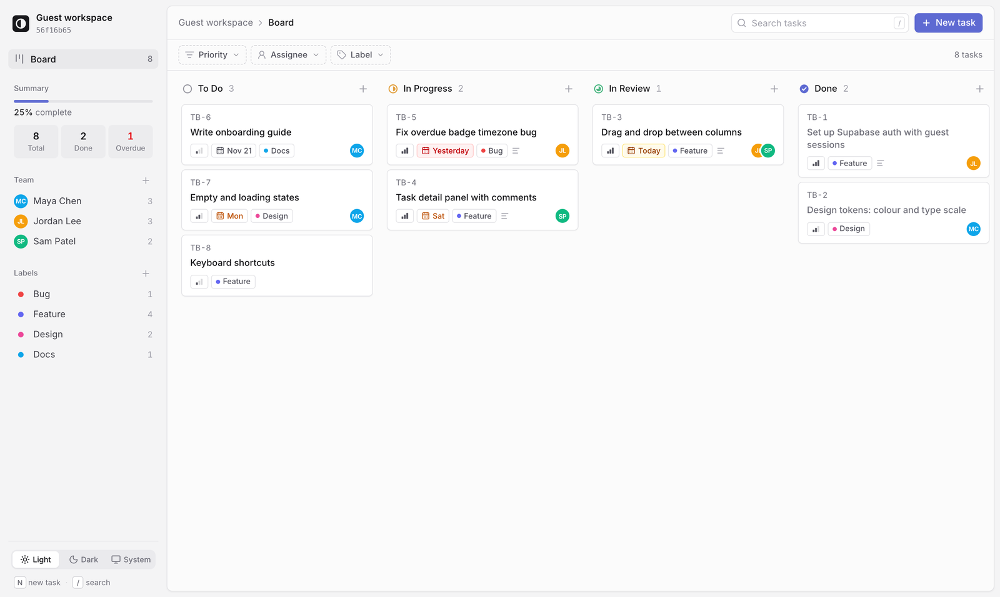
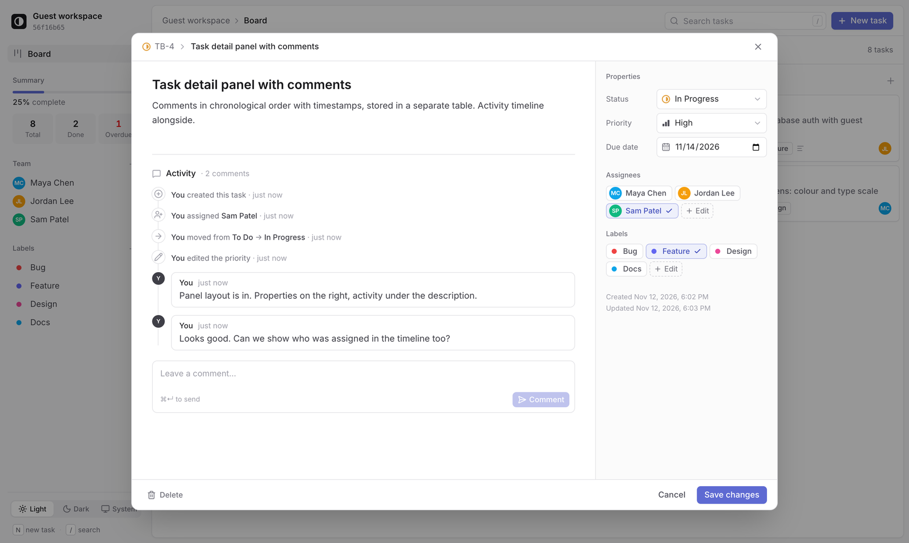
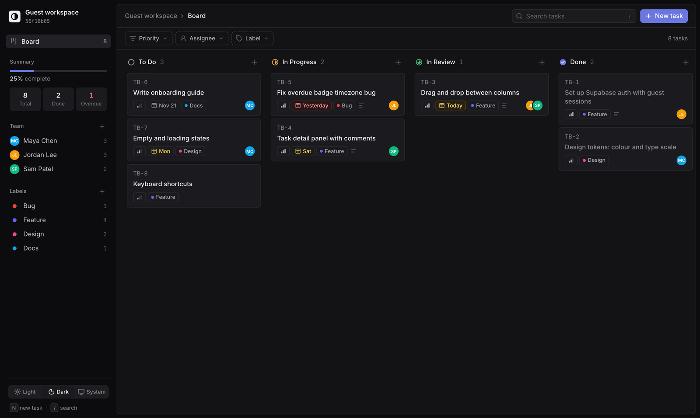
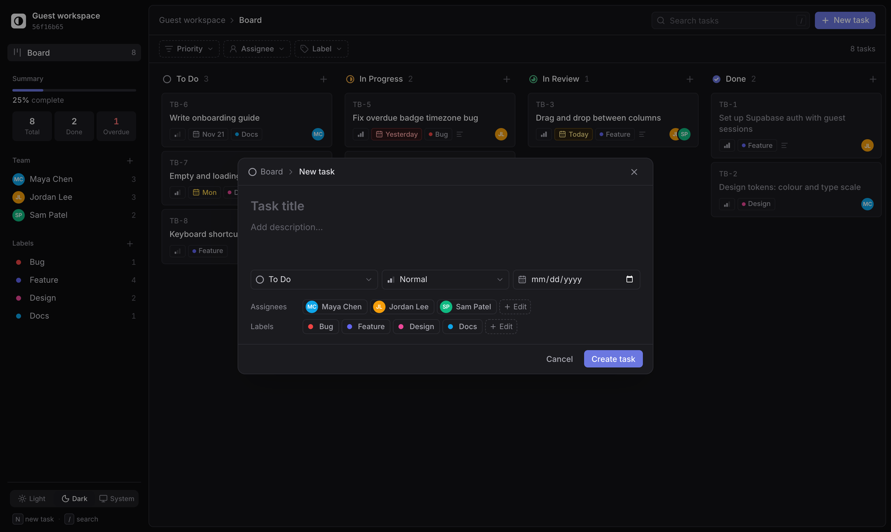
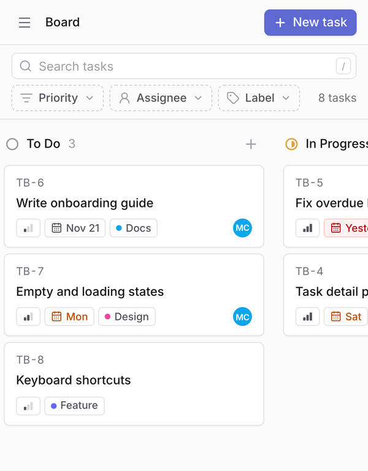

# Taskboard

A Kanban task board in the style of Linear and Asana. Open it and you get a private
workspace straight away, with no sign-up: create tasks, drag them across columns,
assign teammates, tag them with labels, and comment on them. Every change is saved
to Postgres, and Row Level Security keeps each visitor's data private.

**[Live demo →](https://task-board-five-beta.vercel.app)**



<table>
  <tr>
    <td width="50%"></td>
    <td width="50%"></td>
  </tr>
  <tr>
    <td align="center"><sub>Task view: comments, activity timeline, properties</sub></td>
    <td align="center"><sub>Dark mode</sub></td>
  </tr>
</table>

## Features

- **Drag and drop:** move tasks between To Do, In Progress, In Review and Done, or
  reorder them within a column. Works with mouse, touch and keyboard. Moves update
  instantly and roll back if the save fails.
- **Guest workspaces:** an anonymous Supabase session is created on first visit, so
  there's no sign-up. Row Level Security means each guest only ever sees their own data.
- **Task details:** title, description, priority, due date, short IDs (`TB-12`),
  multiple assignees and multiple labels.
- **Comments and activity:** a timeline on each task that merges comments with an
  automatic history, e.g. *"moved from To Do → In Progress · 2 hours ago"*.
- **Team and labels:** add teammates (shown as avatars) and colour-coded labels.
  Click either in the sidebar to filter the board.
- **Search and filters:** search titles and descriptions, and filter by priority,
  assignee or label.
- **At a glance:** due-date badges (overdue, today, this week) and a summary of
  total, done and overdue tasks.
- **Polish:** light, dark and system themes; a phone layout with a slide-out
  sidebar; keyboard shortcuts (`N` new task, `/` search, `Esc` close); loading,
  empty and error states throughout.

<p align="center">
  
  &nbsp;
  
</p>

## Tech stack

| | |
|---|---|
| **Frontend** | React 19, TypeScript, Vite |
| **Styling** | Tailwind CSS v4 with design tokens, Inter, lucide icons |
| **Drag and drop** | dnd-kit |
| **Backend** | Supabase: Postgres, anonymous Auth, Row Level Security, triggers |
| **Hosting** | Vercel (deploys on every push to `main`) |

## How it works

**No custom server.** The browser talks to Supabase directly, and security lives in
the database:

- Every table has RLS enabled with an owner-only policy
  (`user_id = auth.uid()`), so a guest can only read or change their own rows.
- Extra restrictive policies stop a guest from linking their tasks to someone else's
  teammates or labels, or commenting on someone else's task.
- The activity log is written only by `security definer` triggers. Clients can read
  their history but can't write to it, so it can't be faked or skipped.
- Task IDs (`TB-n`) are assigned by a trigger under a per-user lock, with a unique
  index behind it.

**Ordering.** Each task stores a floating-point `position`. A drop takes the midpoint
of its new neighbours, so reordering writes a single row.

**Theming.** Colours are CSS variables (app, panel, surface, accent and a neutral
scale). Dark mode re-maps the variables in one place instead of adding `dark:`
classes to every element.

The full schema, with tables, policies and triggers, is in
[`supabase/schema.sql`](supabase/schema.sql).

## Run it locally

You'll need Node.js 20+ and a free [Supabase](https://supabase.com) project.

1. **Database:** in Supabase, open **SQL Editor → New query**, paste
   [`supabase/schema.sql`](supabase/schema.sql) and run it.
2. **Guest sign-in:** under **Authentication → Sign In / Providers**, turn on
   **Allow anonymous sign-ins**.
3. **Keys:** copy `.env.example` to `.env` and fill in the values from
   **Project Settings → API**:
   ```
   VITE_SUPABASE_URL=https://<project-ref>.supabase.co
   VITE_SUPABASE_ANON_KEY=<publishable / anon key>
   ```
   Only the public anon key belongs here. Never use the service-role key in the frontend.
4. **Start:**
   ```bash
   npm install
   npm run dev
   ```
   Then open http://localhost:5173.

To deploy, import the repo into Vercel (it detects Vite) and add the same two
environment variables.

## Project structure

```
src/
  App.tsx                 session gate, layout, filters, keyboard shortcuts
  components/
    Sidebar.tsx           workspace, summary, team and label filters, theme switch
    TopBar.tsx            breadcrumb, search, new task
    FilterBar.tsx         priority / assignee / label filters
    Board.tsx             drag-and-drop context and drop → position logic
    Column.tsx            droppable column with sortable cards
    TaskCard.tsx          card UI and sortable wrapper
    TaskDialog.tsx        issue-style task view and new-task modal
    TaskThread.tsx        merged comments and activity timeline
    TeamDialog.tsx        manage teammates and labels
    icons.tsx             status and priority icons
  hooks/                  guest session, tasks, team, thread, theme, toasts
  lib/                    Supabase client, types, filters, dates, colours
supabase/
  schema.sql              tables, RLS policies and triggers
```

## What I'd add next

- Live updates across tabs with Supabase Realtime
- Upgrading a guest to a full account so real teammates can join
- Logging label changes in the activity timeline
- Automated tests: unit tests for ordering and filters, plus an end-to-end test for
  create → drag → reload and two-user isolation
